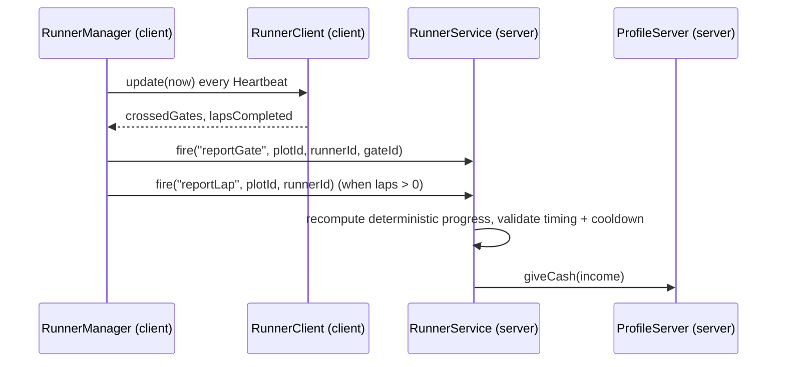
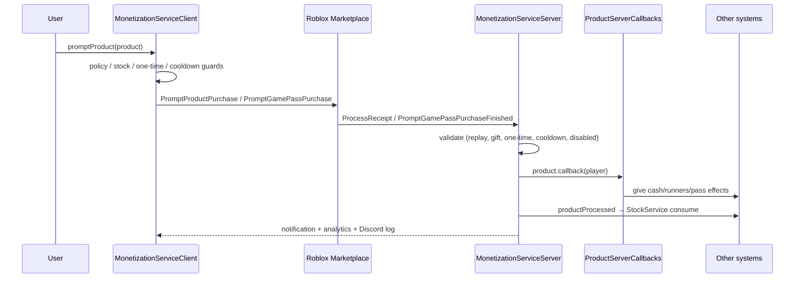

# Data Flow

End-to-end flows through the game. Each flow lists the exact entry point, the server authority, and the client effects. Use this page to trace "where does X come from" before changing a system.

## Income (gate crossings)



1. `RunnerManager.update` (`src/classes/runner/RunnerManager.luau`) runs on one client `Heartbeat`. It calls `car:update(now)` for every car on every **active** plot.
2. `RunnerClient.update` (`src/classes/runner/Client.luau`) moves the model and returns gate ids crossed since the previous frame and laps completed (owner plots only).
3. For each gate the client fires `reportGate`; for each completed lap it fires `reportLap`. Display effects (floating `+$` billboard, `moneyPickup` sound) are client-local and purely cosmetic.
4. `RunnerService.reportGate` (`src/services/runnerService/Server.luau`) recomputes the runner's position from `workspace:GetServerTimeNow()` and pays only if the crossing is inside `GATE_TOLERANCE_SECONDS = 2` and the `(runnerId, gateId)` pair has not paid within `LAP_COOLDOWN_RATIO = 0.85` of a lap.
5. `reportLap` anchors lap accounting per runner id and decrements `lapsLeftToAcquire` by whole laps only.

Server payout formula (single source of truth — keep client displays in sync):

```
income = max(1, round(
    getRunnerIncomePerLap(level)
  * getCashBonusMultiplier(cashBonusLevel)
  * FriendServiceServer:getFriendMultiplier(player)
  * cashMultiplier          -- rebirths
  * customMultiplier        -- starter pack / group reward
  * vipMultiplier           -- 1.5 if VIP
  * doubleCashMultiplier    -- 2 if x2 Cash
  * state.trailMultiplier   -- selected trail
  * RouteServiceUtils[route].cashMultiplier
))
```

Multiplier plumbing is documented in [`economy.md`](../systems/economy.md) § "Income multipliers".

## Merge

```mermaid
sequenceDiagram
    participant PC as PlotClient (client)
    participant PS as PlotServer (server)
    participant DS as DataService profile
    participant RS as RunnerService (server)
    participant RC as RunnerManager (client)

    PC->>PS: fire("merge")
    PS->>PS: pair equal levels, cascade; left input keeps its id, phase re-anchored
    PS->>DS: rewrite runners array + index levels
    PS->>RS: beginMergeEffect(plotId)
    PS->>RS: playMergeEffect(plotId, operations)
    RS->>RC: fireAll("playMergeEffect", plotId, operations)
    Note over RS,RC: broadcasts paused until effect duration ends
    RS->>RC: fireAll("applyRunnerDelta", …) after the effect
    RC->>RC: remove consumed ids / upsert result entries
```

- Merge logic lives in `Plot.merge` (`src/classes/plot/Server.luau`): equal levels pair into `level + 1`, repeatedly until stable. Exclusive cars (ids ≥ 1000) never merge.
- Auto-merge triggers when a `runners` array insert brings the count to **20** (`Plot._watchRunners`).
- Merge rewrites the whole `runners` array via `DataService:arrayRemove`/`arrayInsert`. `_isApplyingRunnerMerge` suppresses the auto-merge watcher while this happens.
- `RunnerServiceServer:beginMergeEffect` pauses snapshot broadcasts; `playMergeEffect` broadcasts the operation list and resumes after the computed animation duration. The resume message is a diff (consumed ids removed, result entries upserted), not a full roster.
- The client hears the same broadcast and runs `MergeEffects.play` (sources resolved by `runnerId`); the delta then reconciles the car pool. Analytics `runnerMerged` is sent once per cascade.

## Laps → crate → trail

1. `RunnerClient` counts laps; `RunnerManager` fires `reportLap`.
2. `RunnerService.reportLap` validates and calls `_spendLaps`, which subtracts whole laps from `lapsLeftToAcquire` (clamped at 0).
3. `lapsLeftToAcquire <= 0` makes the plot's crate rollable. The crate model was built from `ReplicatedStorage.Assets.Blocks[<luckyBlockInQueue>]` by `Plot.buildCrate`/`_watchCrate`; the client shows the prompt.
4. `BlockServiceClient:openCrate()` → `fetch("openCrate")` → `BlockService._openCrate` rolls the trail with `Blocks.rollTrail`, grants it via `profile:giveTrail`, queue-rolls the next crate with `Blocks.rollBlock`, and returns `{ crateId, trailId }`.
5. `CratesSlice.actions.beginRolling` opens `CratesScreen`; the reel is cosmetic — the winner is forced from the server's `trailId`.
6. Rare drops (`Epic`/`Legendary`/`Mythic`/`Secret`) are announced to all servers' chat via `fireAll("announceDrop")`.

Purchased crates take a different path: the receipt callback calls `BlockServiceServer:grantPurchasedCrate`, which rolls and grants **before** the animation and then sends `beginPurchasedRolls`. Details in [`crates-and-stock.md`](../systems/crates-and-stock.md).

## Robux purchase



- Products are defined in `src/services/monetizationService/modules/Products.luau`; effects are wired in `modules/ProductServerCallbacks.luau` (required for side effects by the server entrypoint).
- Receipt decision semantics: `PurchaseGranted` (success or deliberate soft-fail), `NotProcessedYet` (retry), `not false → soft fail` — see [`monetization.md`](../systems/monetization.md).
- Gamepass ownership is cached in profile data (`__gamepasses`) and recovered on join via `UserOwnsGamePassAsync`.
- Stocked products (`exclusiveCar`, `stock = 1_000`) are gated at prompt time by `StockService` and incremented after the receipt is granted.

## Gift

1. Gift button (`RobuxButton`) sets `ShopSlice.state.giftingProduct` and opens `GiftingMenu`.
2. `promptGift(receiverUserId, product.giftId)` → server checks receiver online, not already owning, cooldown, stock; marks `giftingTo`.
3. The buyer's receipt arrives for the **gift product id**; the callback delivers either locally (`receiveGift`) or cross-server via `DataService:sendGlobalMessage("gift", receiverUserId, …)`.
4. `receiveGift` fires `_receivedGift` to the receiver; the client opens `GiftReceivedMenu`. Gamepass gifts go through `awardGamepass`; dev-product gifts run the normal callback.

## Offline earnings

1. `profileService`'s player-removing callback stores `stats.lastLogoutTime` and clears `offlineEarnings`/`offlineEarningsPaid`/`offlineEarningsDoubled`.
2. On join, `OfflineEarnings._create` waits for data and the plot, computes earnings from path/gates/runner roster (900 s minimum, 12 h cap, ×0.7), and stores `offlineEarnings`.
3. The client detects the positive value, opens `OfflineRewards`, and calls `requestBegin` — **which already pays the reward** and sets `offlineEarningsPaid`.
4. `requestClaim` pays only if unpaid, then clears all three keys. A `doubleOfflineEarnings` purchase doubles the pending amount or adds the difference if the base was already paid.

## Rebirth and route change

- `RebirthMenu` → `fetch("rebirth")` → `RebirthService` checks `calculateCashRequirement(rebirths + 1)`, wipes cash/upgrades/extra gates, increments `rebirths`, sets `cashMultiplier = 1 + 0.05 * rebirths`, and grants `runnerSpawnLevel + 1` on even rebirths ≤ 80. `Plot._watchRunnerSpawnLevel` then bumps low-level runners.
- The `skipRebirth` product grants the same rewards with no wipe.
- `RouteService._watchRebirths` reacts to the `rebirths` data signal and moves the player to the strongest unlocked route if they were already on the previous best (`GetBestRoute`).
- Selecting a route (`fetch("selectRoute")`) validates `rebirthRequirement`, then rebuilds the runway (`Plot:buildRunway`), resets runner timing (`resetForRouteChange`), and rebuilds gates (`rebuildAllGates`).

## Tutorial

`TutorialRoot` (`src/ui/Tutorial/TutorialRoot.luau`) is mounted as a UI root and drives steps 1–13 by watching data signals and menu state. `advanceTo` reports the completed stage, saves the next through `TutorialService:saveStage`, and runs the next step. Server-side, `TutorialService` writes `tutorial.step`/`tutorial.finished` through `ProfileServer` and emits `tutorialStep`/`tutorialFinished` markers. Details in [`tutorial.md`](../systems/tutorial.md).

## Analytics

Gameplay calls `AnalyticsServiceClient`/`AnalyticsServiceServer` or `Markers`. The client half forwards over the `"AnalyticsService"` networker; the server validates, throttles client events, and sends to Gamebeast markers plus (live only) the Roblox onboarding funnel. Purchase revenue is only reported on the `PurchaseGranted` path. Details in [`analytics.md`](../systems/analytics.md).
